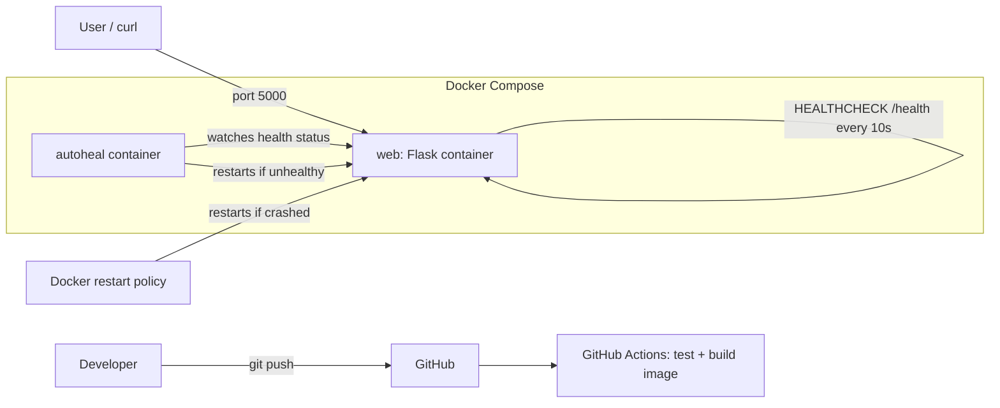

# 🩺 Auto-Healing Docker Application

A beginner-friendly DevOps project: a Flask app in Docker that **detects failures and recovers on its own**, with CI/CD via GitHub Actions.

## Project structure

```
auto-healing-docker-app/
├── app/
│   ├── app.py              # Flask app
│   └── templates/index.html
├── tests/test_app.py       # Pytest tests
├── .github/workflows/ci.yml
├── Dockerfile
├── docker-compose.yml
├── requirements.txt
├── requirements-dev.txt
├── pytest.ini
├── .dockerignore
├── .gitignore
└── README.md
```

## Architecture



## How self-healing works

| Failure | Detected by | Fixed by |
|---|---|---|
| App process crashes (`/crash`) | Container exits | `restart: unless-stopped` |
| App hangs / reports errors (`/break`) | Docker health check (`/health` → 503) | `autoheal` container restarts it |

> Docker's restart policy only reacts to *exits*, not *unhealthy* status. That's why the small `autoheal` service is included.

## Run locally

Requirements: Docker + Docker Compose v2.

```bash
docker compose up --build -d
```

Open http://localhost:5000

## Test the recovery

```bash
# 1. Check health
curl http://localhost:5000/health

# 2. Watch containers in a second terminal
watch -n 2 docker ps

# 3. Simulate a crash
curl -X POST http://localhost:5000/crash
docker ps          # RESTARTS count increases, container comes back

# 4. Simulate an unhealthy app
curl -X POST http://localhost:5000/break
curl http://localhost:5000/health    # 503
# wait ~30-40 seconds
curl http://localhost:5000/health    # 200 again

# 5. See what happened
docker logs autoheal
docker inspect --format '{{json .State.Health}}' auto-healing-app
```

## Run tests without Docker

```bash
python -m venv venv
source venv/bin/activate        # Windows: venv\Scripts\activate
pip install -r requirements-dev.txt
pytest -v
```

## CI/CD

On every push, GitHub Actions: (1) installs dependencies and runs `pytest`, (2) builds the Docker image, (3) starts it and calls `/health` as a smoke test.

## Stop everything

```bash
docker compose down
```

## Ideas to extend

Push the image to Docker Hub, add Prometheus metrics, deploy to a VPS.
