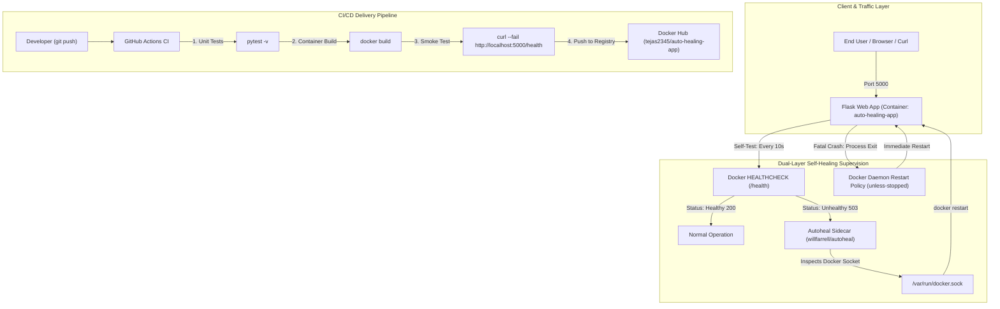
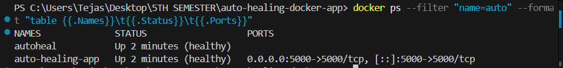
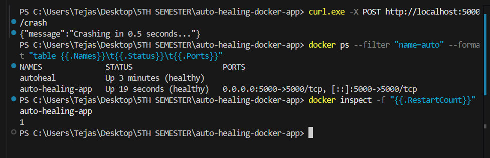
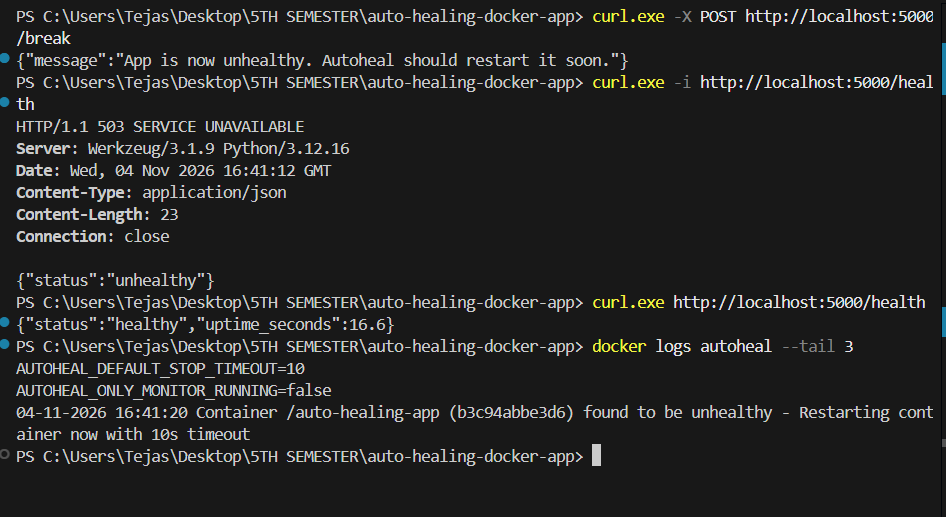
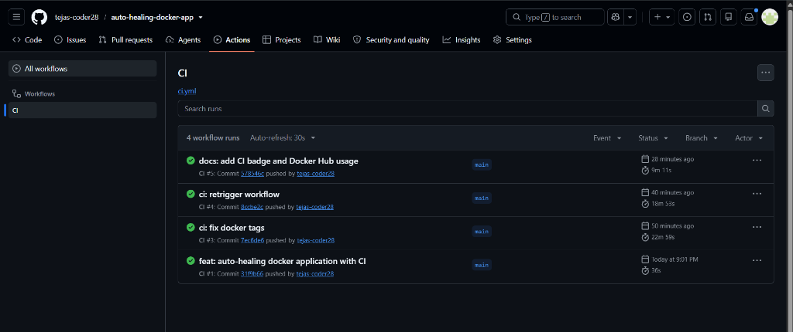

<div align="center">

# Auto-Healing Docker Application

<p>High-availability self-healing container architecture with automated Docker health checks, process crash recovery, and GitHub Actions CI/CD</p>


</div>

---


Production cloud environments frequently encounter service degradation, unhandled thread panics, and silent deadlock states where processes appear running but fail to serve client requests. While native container restart policies handle hard process crashes, they cannot identify or remediate silent application failures that cause services to become unresponsive. This project solves silent container failures by implementing a dual-layer self-healing architecture: native Docker restart policies recover from fatal process terminations, while a decoupled autoheal sidecar monitors HTTP health check endpoints and restarts degraded containers before outages impact end users.

---


- **Dual-Layer Auto-Recovery**: Combines Docker daemon restart policies (`restart: unless-stopped`) for hard crashes with an autoheal sidecar monitor for silent application failures.
- **Automated Health Probes**: Configures Docker engine `HEALTHCHECK` with calibrated intervals, timeouts, retries, and start periods querying `/health`.
- **Fault-Injection Test Harness**: Interactive REST control routes (`POST /crash` and `POST /break`) enabling instant simulation of fatal process exits and 503 service degradation.
- **Least-Privilege Security Hardening**: Non-root container runtime execution (`appuser`) adhering to Docker security best practices and minimal footprint `python:3.12-slim` base image.
- **Automated CI/CD Pipeline**: GitHub Actions automation testing Python logic with `pytest`, validating containerized build health via smoke tests, and publishing multi-tag images to Docker Hub.

---


| Layer | Technology |
|---|---|
| **Application Runtime** | Python 3.12, Flask 3.1 |
| **Containerization & Orchestration** | Docker Engine, Docker Compose v2 |
| **Supervision & Self-Healing** | Native Docker Healthcheck, Will Farrell Autoheal Sidecar |
| **Testing & Quality Assurance** | Pytest 8.3 |
| **CI/CD & Automation** | GitHub Actions (Ubuntu Runners, Docker Hub Integration) |
| **Container Registry** | Docker Hub (`tejas2345/auto-healing-app`) |

---




---


### Prerequisites
- [Docker](https://www.docker.com/) and [Docker Compose v2](https://docs.docker.com/compose/) installed
- Python 3.12+ (optional, only for running local tests without Docker)
- Git installed on your system

### 1. Clone the Repository
```bash
git clone https://github.com/tejas-coder28/auto-healing-docker-app.git
cd auto-healing-docker-app
```

### 2. Environment Configuration
Copy the sample environment variables:
```bash
cp .env.example .env
```

### 3. Launch with Docker Compose
Start both the web application and the autoheal sidecar supervisor in detached mode:
```bash
docker compose up --build -d
```
Access the application dashboard at `http://localhost:5000`.

### 4. Verify Active Container Health
```bash
docker ps
```
The `auto-healing-app` container will show `(health: starting)` during initial startup, transitioning to `(healthy)` within 10 seconds.

### 5. Simulate Failure Scenarios & Verify Self-Healing

#### Scenario A: Process Crash Simulation (Immediate Exit)
```bash
# Trigger an abrupt process termination (os._exit)
curl -X POST http://localhost:5000/crash

# Check container status
docker ps
```
*Result: Docker's native `restart: unless-stopped` policy detects the non-zero exit code and reboots the container within seconds. The restart counter increments.*

#### Scenario B: Silent Failure Simulation (Unhealthy State)
```bash
# Trigger an internal application error (sets healthy=False)
curl -X POST http://localhost:5000/break

# Verify the health endpoint returns HTTP 503
curl http://localhost:5000/health

# Inspect autoheal monitoring logs
docker logs -f autoheal
```
*Result: Docker marks the container `(unhealthy)` after 3 failed health probes (~30 seconds). The `autoheal` sidecar detects the status and automatically issues a container reboot, restoring HTTP 200 health.*

### 6. Run Unit Tests (Without Docker)
```bash
# Create and activate virtual environment
python -m venv venv

# Windows (PowerShell / Command Prompt)
.\venv\Scripts\activate

# macOS / Linux
source venv/bin/activate

# Install dependencies and execute test suite
pip install -r requirements-dev.txt
pytest -v
```

### 7. Teardown
```bash
docker compose down
```

---


```
auto-healing-docker-app/
├── .github/
│   └── workflows/
│       └── ci.yml               # GitHub Actions CI/CD test, build & Docker Hub push
├── app/
│   ├── templates/
│   │   └── index.html           # Web status dashboard and failure simulation UI
│   └── app.py                   # Flask server, health check endpoints & fault triggers
├── docs/
│   └── assets/                  # Proof-of-recovery logs and CI/CD verification screenshots
├── tests/
│   └── test_app.py              # Pytest unit tests for status codes & endpoints
├── .dockerignore                # Excluded build artifacts and virtual environments
├── .env.example                 # Environment variable template
├── .gitignore                   # Git exclusion rules
├── docker-compose.yml           # Multi-container orchestration (web + autoheal)
├── Dockerfile                   # Non-root multi-stage Python 3.12 slim container
├── LICENSE                      # MIT License
├── pytest.ini                   # Pytest test discovery settings
├── requirements.txt             # Production Flask runtime dependencies
├── requirements-dev.txt         # Development & testing packages (pytest)
└── README.md                    # Project documentation
```

---


### 1. Healthy Container Status
*Docker container running with active healthcheck reporting healthy status.*



### 2. Process Crash Recovery
*Process termination triggered via `/crash` route, instantly revived by Docker restart policy.*



### 3. Autoheal Sidecar Log Output
*Autoheal sidecar detecting consecutive 503 health check failures and rebooting container.*



### 4. GitHub Actions CI/CD Pipeline
*Automated pipeline successfully running pytest, container smoke testing, and Docker Hub image build.*



---


- **Prometheus & Grafana Telemetry**: Implement Prometheus metrics exporter to track request latencies, failure frequencies, and container restart counters in real time.
- **Webhook Alert Notifications**: Connect autoheal restart events to Discord or Slack webhooks for immediate incident alerting.
- **Kubernetes Liveness & Readiness Probes**: Port Docker Compose health checks into Kubernetes manifests using native liveness and readiness probe specifications.

---


**Tejas Muralidhar**
- GitHub: [@tejas-coder28](https://github.com/tejas-coder28)
- LinkedIn: [Tejas Muralidhar](https://www.linkedin.com/in/tejasmuralidhar)
