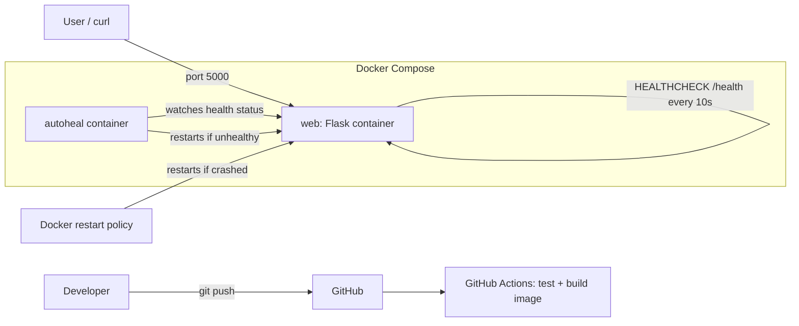

# 🩺 Auto-Healing Docker Application


A beginner-friendly DevOps project: a Flask app in Docker that **detects failures and recovers on its own**, with CI/CD via GitHub Actions.

## Demo

Screenshots coming soon

1. **Crash Test**: Run `curl -X POST http://localhost:5000/crash` and observe Docker's `restart: unless-stopped` policy restart the container after the process exits.
2. **Break Test**: Run `curl -X POST http://localhost:5000/break` to simulate an unhealthy app (HTTP 503), and watch the `autoheal` container detect consecutive health check failures and restart the app.

## Project structure

```
auto-healing-docker-app/
├── app/
│   ├── app.py              # Flask app
│   └── templates/index.html
├── tests/test_app.py       # Pytest tests
├── .github/workflows/ci.yml
├── Dockerfile
├── docker-compose.yml
├── requirements.txt
├── requirements-dev.txt
├── pytest.ini
├── .dockerignore
├── .gitignore
└── README.md
```

## Architecture



## How self-healing works

| Failure | Detected by | Fixed by |
|---|---|---|
| App process crashes (`/crash`) | Container exits | `restart: unless-stopped` |
| App hangs / reports errors (`/break`) | Docker health check (`/health` → 503) | `autoheal` container restarts it |

> Docker's restart policy only reacts to *exits*, not *unhealthy* status. That's why the small `autoheal` service is included.

## Run locally

Requirements: Docker + Docker Compose v2.

```bash
docker compose up --build -d
```

Open http://localhost:5000

## Run from Docker Hub

```bash
docker run -p 5000:5000 tejas2345/auto-healing-app:latest
```

## Test the recovery

```bash
# 1. Check health
curl http://localhost:5000/health

# 2. Watch containers in a second terminal
watch -n 2 docker ps

# 3. Simulate a crash
curl -X POST http://localhost:5000/crash
docker ps          # RESTARTS count increases, container comes back

# 4. Simulate an unhealthy app
curl -X POST http://localhost:5000/break
curl http://localhost:5000/health    # 503
# wait ~30-40 seconds
curl http://localhost:5000/health    # 200 again

# 5. See what happened
docker logs autoheal
docker inspect --format '{{json .State.Health}}' auto-healing-app
```

## Run tests without Docker

```bash
python -m venv venv
source venv/bin/activate        # Windows: venv\Scripts\activate
pip install -r requirements-dev.txt
pytest -v
```

## CI/CD

On every push, GitHub Actions: (1) installs dependencies and runs `pytest`, (2) builds the Docker image, (3) starts it and calls `/health` as a smoke test.

## Stop everything

```bash
docker compose down
```

## What I Learned

- **Docker Health Checks**: Configuring internal container health checks using `HEALTHCHECK` with custom `interval`, `timeout`, `retries`, and `start-period` parameters.
- **Docker Restart Policies**: Understanding how policies like `unless-stopped` automatically recover containers when the main process exits or crashes.
- **Why Autoheal is Needed**: Docker restart policies only react to process crashes/exits, not unhealthy application states; a sidecar like `willfarrell/autoheal` is necessary to monitor health status and trigger restarts.
- **CI with GitHub Actions**: Automating local test suites (`pytest`), container image builds, and containerized smoke tests on every push and pull request.

## Challenges

- **Unhealthy vs. Exited Containers**: Native Docker restart policies ignore container health status, requiring an external monitor/watcher pattern to heal silently broken services.
- **Health Check Timing**: Balancing `interval`, `timeout`, and `retries` to ensure quick failure recovery without false-positive restarts during momentary load spikes.

## Future Improvements

- **Docker Hub Push**: Automatically publish tagged and versioned container images to Docker Hub on successful CI runs.
- **Prometheus & Grafana**: Export application metrics and build dashboards to monitor request rates, latencies, and restart occurrences.
- **Cloud Deployment**: Deploy the Docker Compose stack to a cloud virtual machine or managed container platform (e.g., AWS EC2, GCP, or a VPS).
- **Slack Alerts**: Trigger real-time notifications to a Slack channel when container crashes or autoheal restarts take place.
